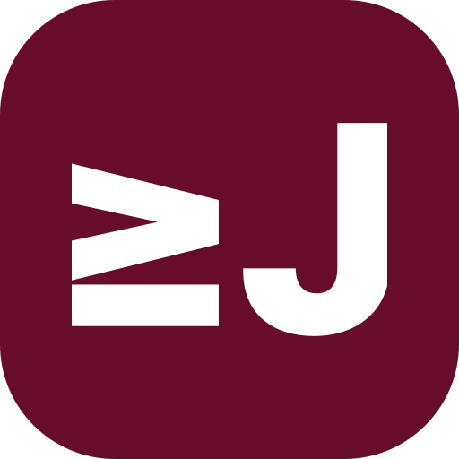

<div align="center">

# jyje/image-system



개인 디자인 시스템을 위한 이미지 생성 워크플로와 재사용 갤러리입니다.

[English](README.md) / [한국어](README-ko.md) / [갤러리](gallery/README-ko.md) / [문서](docs/README-ko.md)

</div>

jyje 개인 프로젝트에 쓸 이미지를 만들고 다시 쓰는 저장소입니다. 먼저 갤러리에서 찾아보고, 맞는 이미지가 있으면 파일을 바로 씁니다. 새 이미지가 필요하면 기존 팔레트, 스타일, 레시피를 가져와 용도에 맞게 바꿉니다.

기본 강조색은 `jyje/profile`과 `jyje/profile-2`에서 공통으로 쓰는 팥죽색 `#680C2C`입니다.

## 시작하기

GitHub나 Markdown 미리보기에서 [갤러리](gallery/README-ko.md)를 엽니다. 초기 방향을 비교할 수 있는 자체 제작 SVG 샘플 2종이 들어 있습니다. 샘플과 사용 승인 자산은 구분해 표시합니다.

Node.js 22에서 갤러리를 갱신하고 검증할 수 있습니다. 외부 패키지 설치가 필요 없습니다.

```sh
node scripts/gallery.mjs build
node scripts/gallery.mjs check
```

- [프로젝트 목표](GOAL-ko.md)에 프로젝트 목적과 성공 기준을 정리했습니다.
- [프로젝트 계획](PLAN-ko.md)에서 초기 갤러리와 생성 파일럿의 진행 상황을 관리합니다.
- [문서](docs/README-ko.md)에서 큐레이션, 검수, 공개 사례를 확인할 수 있습니다.
- [catalog/catalog.json](catalog/catalog.json)에서 갤러리의 원본 데이터를 관리합니다.
