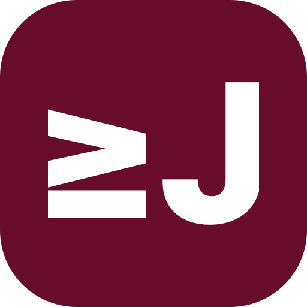

# 브랜드 에셋

[English](README.md) / [한국어](README-ko.md)

## jyje 로고

[jyje.svg](jyje.svg)는 팥죽색 `#680C2C`를 배경으로 한 정사각형 로고입니다. 아래 표는 같은 SVG를 실제 표시 크기로 렌더링합니다.

| 16px | 32px | 64px | 112px |
| :---: | :---: | :---: | :---: |
|  |  |  |  |
| 파비콘 검수 | 작은 아이콘 | 썸네일 | 프로젝트 README |

작은 크기에서는 흰색 획 사이의 여백과 글자의 구분을 확인합니다. 파비콘은 브라우저 탭에서도 검수합니다.

원본은 `jyje/profile`의 `assets/icons/jyje.svg`입니다. 이 버전은 512px 기준의 획 두께를 유지하면서, 다른 표시 크기에서는 획도 로고와 같은 비율로 줄어들도록 조정했습니다.
