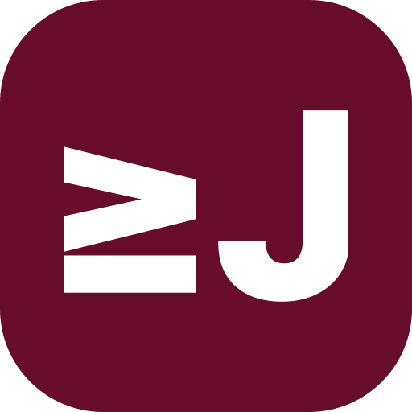

# Brand Assets

[English](README.md) / [한국어](README-ko.md)

## jyje logo

[jyje.svg](jyje.svg) is the square jyje logo on a red-bean background (`#680C2C`). The table renders the same SVG at four display sizes.

| 16px | 32px | 64px | 112px |
| :---: | :---: | :---: | :---: |
|  |  |  |  |
| [jyje-16x16.png](jyje-16x16.png) | [jyje-32x32.png](jyje-32x32.png) | [jyje-64x64.png](jyje-64x64.png) | [jyje-112x112.png](jyje-112x112.png) |
| Favicon review | Small icon | Thumbnail | Project README |

Each PNG is rendered directly from the SVG at its listed pixel size, with transparent corners. Save new exports in this directory as `jyje-<width>x<height>.png`, for example `jyje-48x48.png`. The gallery finds matching files during the build, checks their dimensions, and shows them from smallest to largest. Select a preview or use the menu, then choose **Copy URL**.

At small sizes, check that the white strokes remain distinct and that the gaps between them stay visible. Review the favicon in an actual browser tab.

The source is `assets/icons/jyje.svg` in `jyje/profile`. This version preserves the stroke weight at the 512px reference size and scales it proportionally at other display sizes.
