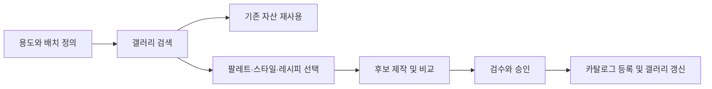

# 큐레이션과 검수

[English](curation.md) / [한국어](curation-ko.md)

## 작업 흐름

1. **브리프**. 어디에 쓰는 이미지인지, 이미지가 어떤 메시지를 보조하는지, 크롭과 텍스트 배치 영역을 정합니다.
2. **레시피**. 팔레트 ID, 스타일 ID, 출력 크기, 구성과 금지 요소를 기록합니다. 외부 생성 도구를 썼다면 모델·버전, 최종 프롬프트, 참조 이미지의 용도와 강도, 시드 등 도구가 제공한 실행 조건을 남깁니다.
3. **후보 비교**. 같은 주제로 색 또는 스타일 조건을 하나씩 바꿉니다. 색은 HEX와 함께 배경·강조·중립 등 역할을 지정합니다. 출력에 정확한 색이 필요한 면은 후편집으로 맞춘 뒤 최종 파일을 기준으로 확인합니다.
4. **승인**. 아래 기준을 실제 배치에 대입한 후, 재사용 범위가 확인된 이미지와 기록을 등록합니다.

## 팔레트

- **Profile Light** (`profile-light-v1`). `jyje/profile`의 `_config.yml`에 있는 `rgb(104, 12, 44)`와 `jyje/profile-2`의 `src/css/custom.css`에 있는 `--site-accent`가 가리키는 공통 색 `#680C2C`를 기본 강조색으로 씁니다. 흰 배경, 청회색 잉크, 옅은 표면색은 `profile-2` 라이트 테마에서, 연분홍 보조색 `#FBE1E9`는 같은 파일의 다크 테마 색상 단계에서 가져왔습니다.
- **Profile Dark** (`profile-dark-v1`). 어두운 배경용입니다. 배경 `#13242E`와 강조색 `#F0A6BF`를 비롯한 색을 `profile-2` 다크 테마에서 가져왔습니다.
- 카탈로그의 `defaultPalette`는 새 레시피를 작성할 때의 기본 선택입니다. 각 레시피에 팔레트 ID를 명시해 기본값이 바뀌어도 기존 이미지의 제작 조건을 추적할 수 있게 합니다.

## 승인 기준

| 항목 | 확인할 내용 |
| --- | --- |
| 용도 | 의도한 화면이나 문서에서 이미지의 역할이 분명하고, 주변 문구와 핵심 UI가 여전히 눈에 들어오는가 |
| 색 | 주요 색이 지정된 역할을 지키고 강조색의 비중이 적절한가 |
| 스타일과 구도 | 형태·선·질감이 의도와 맞고, 실제 크롭에서 대상과 텍스트 여백이 유지되는가 |
| 접근성 | 의미를 전달하는 이미지는 대체 텍스트를 제공하고, 실제 배치에서 텍스트와 핵심 요소의 대비를 확인했는가 |
| 출처 | 입력·참조·출력의 사용 범위, 제작 도구와 조건을 확인할 수 있는가 |

## 등록과 유지보수

- `catalog/catalog.json`의 팔레트·스타일·레시피는 `-v1` 같은 버전이 포함된 ID로 연결합니다. 색이나 구도를 바꾸면 새 ID를 만들고, 기존 자산은 원래 ID를 유지합니다. 바뀐 이미지도 새 ID와 파일명으로 저장합니다.
- 초안, 비공개 원본, 참조 파일은 Git에서 제외된 `temp/`에서 관리합니다. 카탈로그에 등록하는 파일은 저장소에 포함할 권한을 먼저 확인합니다.
- 등록 항목은 이미지 경로, 용도와 레시피, 대체 텍스트, 제작 출처(`source`), 재사용 범위(`rights`)를 갖습니다. 갤러리 설명은 카탈로그에 `{ "en": "...", "ko": "..." }` 형식으로 기록합니다. 초기 생성 실험에서는 도구와 실행 조건을 `source`에 기록할 수 있습니다.
- `file`을 대표 미리보기로 쓰고, 같은 이미지를 다른 형식이나 크기로 저장했다면 `variants`에 추가합니다. `quiet-tray-v1.svg`, `quiet-tray-v1.png`, `quiet-tray-v1-200x200.png`처럼 파일명에 같은 자산 ID를 씁니다. SVG, GIF, PNG, JPG, JPEG, WebP, AVIF를 지원하며, 구도나 주제가 달라지면 별도 자산 ID로 등록합니다.
- `sample`은 비교용 예시, `approved`는 검수를 통과한 자산, `archived`는 활성 갤러리에서 내린 자산입니다. 보관 상태의 파일과 기록은 이전 사용처 추적에 활용합니다.
- 등록 후 `node scripts/gallery.mjs build`와 `node scripts/gallery.mjs check`를 실행합니다. 자동 검증은 카탈로그와 영문·국문 갤러리의 동기화를 확인합니다. 실제 배치와 권한은 사람이 검수합니다.

## 다른 프로젝트에서 재사용하기

1. [갤러리](../gallery/README-ko.md)에서 용도별로 승인 이미지를 찾고 카드에서 이미지 파일을 엽니다.
2. 이미지가 그대로 맞으면 사용처에서 접근할 수 있는 파일을 링크합니다. 표시 결과를 고정해야 하면 커밋에 고정한 파일 URL을 쓰거나, 승인 파일을 사용 프로젝트에 복사해 로컬 경로로 참조합니다.
3. 주제나 구도를 바꿔야 하면 연결된 레시피에서 시작해 새 ID로 결과를 등록합니다. 사용할 프로젝트에 자산 또는 레시피 ID와 배치 위치를 기록합니다.
