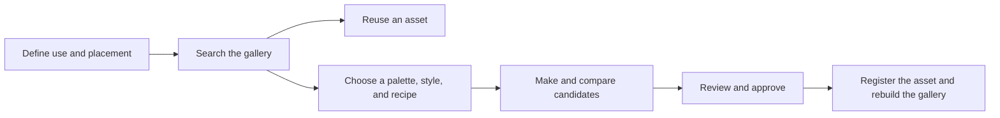

# Curation and Review

[English](curation.md) / [한국어](curation-ko.md)

## Workflow

1. **Brief.** Define where the image will appear, what message it supports, and how it should accommodate cropping and surrounding text.
2. **Recipe.** Record the palette and style IDs, output size, composition, and treatments to avoid. If you use an external tool, record the model and version, final prompt, role and strength of references, and settings the tool exposes, such as the seed.
3. **Comparison.** Change one color or style condition at a time for the same subject. Pair each hex value with its role, such as background, accent, or neutral. If a surface needs an exact color, correct it after generation and check the final file.
4. **Approval.** Review each candidate in its intended placement against the criteria below. Register the image and its record once its reuse terms are clear.

## Palettes

- **Profile Light** (`profile-light-v1`). The default accent is the red-bean tone `#680C2C`, shared by `accent_color` in `jyje/profile` and `--site-accent` in `jyje/profile-2`. The light background, ink, and surface come from the latter's light theme. The pink tint `#FBE1E9` comes from its dark theme's color scale.
- **Profile Dark** (`profile-dark-v1`). For dark backgrounds, use colors from the `profile-2` dark theme, including background `#13242E` and accent `#F0A6BF`.
- Use `defaultPalette` as a starting point for a new recipe. Record the chosen palette ID explicitly so existing recipes remain traceable if the default changes.

## Approval criteria

| Area | What to check |
| --- | --- |
| Use | The image has a clear role in context, and nearby copy and key controls remain easy to find. |
| Color | The main colors serve their assigned roles and the accent has the intended prominence. |
| Style and composition | Shape, line, and texture fit the brief. The subject and space for text survive the actual crop. |
| Accessibility | Meaningful images have alt text. Text and key elements have adequate contrast in the intended placement. |
| Provenance | The tool, production settings, and usage terms for inputs, references, and outputs are recorded. |

## Registration and maintenance

- Use versioned IDs such as `-v1` for palettes, styles, and recipes in `catalog/catalog.json`. Create a new ID when a design changes. Keep existing asset references intact and give a revised image a new ID and filename.
- Keep drafts, private originals, and reference files under the ignored `temp/` directory. Confirm permission to include a file before registering it.
- Record each asset's file, recipe, alt text, source, and reuse terms. Write gallery descriptions as `{ "en": "...", "ko": "..." }` in the catalog. Use `source` to record the tool and settings in the initial experiments.
- Use `sample` for comparison assets, `approved` for reviewed assets, and `archived` for assets retired from the active gallery. Keep archived files and records so past uses remain traceable.
- Run `node scripts/gallery.mjs build` and `node scripts/gallery.mjs check` after registration. The check validates the catalog and both generated gallery READMEs. Placement and reuse terms require human review.

## Reuse in another project

1. Find an approved image by use case in the [gallery](../gallery/README.md). Open the image file from its card.
2. If the file fits, link to it when the destination can access it. Use a commit-pinned file URL when the rendering needs to stay identical, or copy the approved file into the destination project and use a local path.
3. If the subject or composition needs to change, start from the linked recipe and register the new image under its own ID. Record the asset or recipe ID and placement in the project that uses it.
