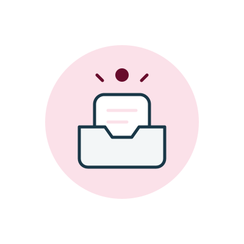
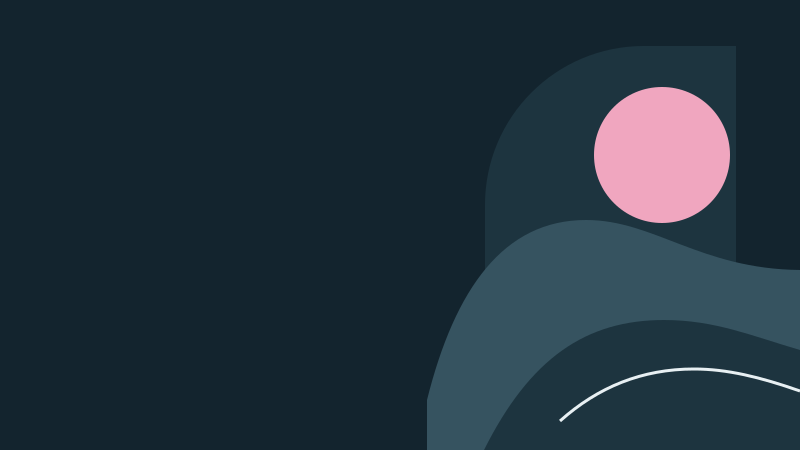

# Image Gallery

<!-- Generated from catalog/catalog.json by scripts/gallery.mjs. -->

[English](README.md) / [한국어](README-ko.md)

[Catalog](../catalog/catalog.json) · [Curation and review](../docs/curation.md)

Default palette Profile Light (`profile-light-v1`) · Accent `#680C2C`

## Approved assets

There are no approved assets yet.

## Comparison samples

### Product empty state

#### Quiet Tray

- Image files · [quiet-tray-v1.svg](assets/quiet-tray-v1.svg) · [quiet-tray-v1.png](assets/quiet-tray-v1.png) · 400 × 400 px
- Palette Profile Light (`profile-light-v1`) · background `#FFFFFF` · surface `#F3F6F7` · ink `#193747` · accent `#680C2C` · accent-tint `#FBE1E9`
- Style Soft Outline (`soft-outline-v1`) · Rounded corners, consistent outlines, flat fills, and low visual emphasis.
- Avoid · Heavy shadows, dense ornament, and text inside the image.
- Recipe `empty-state-spot-v1` · Center a single subject with ample space around it. Reserve the accent color for small elements.
- Source · SVG drawn for this repository.
- Reuse terms · For style comparison within this project.

### Document and presentation banner

#### Tideline

- Image files · [tideline-v1.svg](assets/tideline-v1.svg) · 800 × 450 px
- Palette Profile Dark (`profile-dark-v1`) · background `#13242E` · surface `#1D343F` · ink `#E8F0F3` · accent `#F0A6BF` · muted `#365360`
- Style Layered Cutout (`layered-cutout-v1`) · Large geometric shapes, layered paper-like depth, and a composition weighted to the right.
- Avoid · Photographic textures, strong gradients, and elements that fill the left-hand space.
- Recipe `editorial-cover-v1` · Leave the left half open for a title and layer large shapes on the right. Keep text out of the image.
- Source · SVG drawn for this repository.
- Reuse terms · For style comparison within this project.
